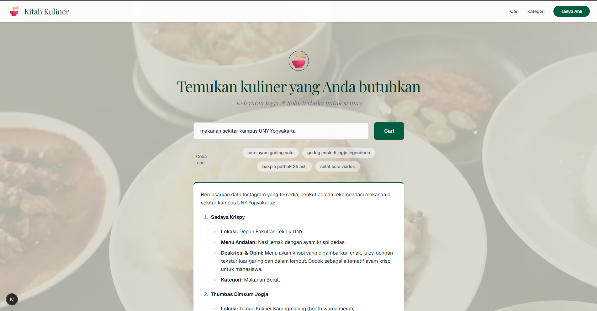

# 🍜 Kitab Kuliner — Culinary RAG

<p align="center">
  
</p>

Kitab Kuliner memberikan rekomendasi kuliner Yogyakarta dan Surakarta (Solo)
berdasarkan data Instagram food vlogger. Proyek ini dikembangkan saat magang
sebagai Data Scientist di DataIns.

Pengguna mengirim satu pertanyaan dan menerima kartu rekomendasi berisi nama
tempat, alamat, jam buka, harga, kategori, deskripsi, serta tautan sumber Instagram.
Saat ini setiap pencarian berdiri sendiri; belum ada riwayat percakapan.

## Stack dan alur aktif

| Bagian | Teknologi |
| --- | --- |
| Frontend | Next.js 16.1.6, React 19.2.3, TypeScript, Tailwind CSS 4 |
| Backend | FastAPI, Pydantic, Uvicorn |
| Integrasi RAG | LangChain Core, LangChain OpenAI, LangChain Pinecone |
| Embedding | Jina AI API, `jina-embeddings-v3`, 512 dimensi |
| Vector database | Pinecone, default index `instaculinary-data` |
| Generasi jawaban | DeepSeek API, `deepseek-chat`, temperature 0.3 |
| Pengolahan data | Pandas dan Jupyter Notebook |

```text
Pertanyaan → Next.js /api/chat → FastAPI /api/chat
           → embedding query Jina → lima dokumen terdekat di Pinecone
           → konteks dan prompt → DeepSeek → JSON → kartu rekomendasi

CSV knowledge base → dokumen dengan ID deterministik → Jina → upsert ke Pinecone
```

Pencarian dan generasi jawaban menggunakan layanan eksternal. ChromaDB dan
embedding lokal `multilingual-e5-small` adalah bagian eksperimen lama, bukan
jalur aplikasi aktif. Wrapper embedding lokal masih tersedia di
`src/sentence_transformer_embedding.py`.

## Menjalankan secara lokal

Prasyarat:

- Python **3.11+**; versi dependensi Python mengikuti environment lokal yang diverifikasi.
- Node.js **20.9+** dan npm untuk Next.js 16.
- API key DeepSeek, Jina AI, dan Pinecone yang masih berlaku.
- Index Pinecone yang sudah tersedia dengan **512 dimensi**, berisi dokumen hasil
  ingest menggunakan model embedding yang sama dengan query.

Jalankan perintah berikut dari root repository.

### 1. Instal backend

PowerShell:

```powershell
python -m venv .venv
.\.venv\Scripts\Activate.ps1
python -m pip install -r requirements.txt
```

Linux/macOS:

```bash
python3 -m venv .venv
source .venv/bin/activate
python -m pip install -r requirements.txt
```

`requirements.txt` menginstal proyek secara editable. Daftar dependensi aplikasi
dan versi langsungnya ditetapkan di `pyproject.toml`, sehingga tidak ada dua daftar
yang harus diperbarui terpisah. Dependensi transitif belum dikunci dalam lockfile.

### 2. Atur environment

Untuk setup baru, salin `.env.example` menjadi `.env` di root. Jika `.env` sudah
ada, cukup lengkapi variabelnya. Isi tiga API key:

```dotenv
DEEPSEEK_API_KEY=isi_api_key_deepseek
JINA_AI_API_KEY=isi_api_key_jina
PINECONE_API_KEY=isi_api_key_pinecone
PINECONE_INDEX_NAME=instaculinary-data
```

`PINECONE_INDEX_NAME` opsional. Backend, CLI, dan script ingest membaca `.env`
dari root proyek. Variabel dari shell atau deployment memiliki prioritas atas
isi `.env`. Kredensial diperiksa saat layanan terkait dipakai; `GET /` hanya
menunjukkan proses API hidup, bukan menguji koneksi ke provider.

Untuk frontend, salin `frontend/.env.example` menjadi `frontend/.env.local` jika
file tersebut belum ada:

```dotenv
BACKEND_URL=http://localhost:8000
```

URL ini diakses oleh server Next.js. Jika backend berada di container atau host
lain, gunakan alamat yang dapat dijangkau dari server Next.js. API key tetap
berada di environment backend.

### 3. Jalankan backend

Dengan virtual environment aktif, dari root:

```bash
python -m uvicorn backend.api:app --reload --port 8000
```

- Status proses: <http://localhost:8000/>
- Dokumentasi API: <http://localhost:8000/docs>

### 4. Jalankan frontend

Di terminal lain:

```bash
cd frontend
npm ci
npm run dev
```

Buka <http://localhost:3000>. Frontend mengirim permintaan ke route Next.js,
kemudian route tersebut meneruskannya ke backend.

### 5. CLI (opsional)

Dengan virtual environment aktif, dari root:

```bash
python -m src.main
```

CLI menggunakan retrieval, prompt, dan konfigurasi DeepSeek yang sama dengan web.

## Data dan ingest Pinecone

Dataset belum dipublikasikan. Clone repository saja tidak menyertakan CSV,
notebook, model lokal, atau kredensial karena direktori/file tersebut diabaikan Git.
Simpan backup data dan notebook secara terpisah dari VPS dan repository.

Tahapan pengolahan data:

```text
data/01_raw/                       Data scraping Instagram
data/02_intermediate_extraction/   Ekstraksi awal dan kategorisasi
data/03_advance_extraction/        Ekstraksi deskripsi/opini dengan LLM
data/04_knowledge_base/            Knowledge base final
```

File yang dibaca script ingest adalah
`data/04_knowledge_base/knowledge_base_v2.csv`, dengan kolom:

```text
id, sumber, nama_tempat, alamat, jam_buka, jam_tutup, harga,
kategori, deskripsi, opini, url, daerah
```

Jika index perlu diisi atau datanya diperbarui, jalankan dari root:

```bash
python -m src.create_vector_db
```

Perintah tersebut memanggil API Jina dan menulis ke Pinecone; penggunaan dapat
menghabiskan kuota provider. Script tidak membuat index Pinecone. Buat/pastikan
index 512 dimensi terlebih dahulu dan gunakan API key untuk project yang benar.
ID vektor menggunakan `str(id)` dari CSV, sehingga ingest ulang memperbarui ID
yang sama. Baris yang dihapus dari CSV **tidak otomatis dihapus dari Pinecone**.

Sebelum embedding/upload, script memvalidasi kolom wajib, ID yang terisi dan unik,
serta nama tempat yang terisi. ID dibaca sebagai string agar nol di depan tidak
hilang. URL postingan opsional; jika tidak tersedia atau tidak valid, tautan
beralih ke profil akun Instagram yang valid. Nilai kosong diberi penanda
`Informasi tidak tersedia`, dan sumber akun dinormalisasi menjadi `@namaakun`.
Konteks dari dokumen index lama juga dibersihkan saat retrieval.

Ingest mengembalikan exit code 0 jika selesai dan 1 jika gagal. Upload banyak
batch bukan transaksi atomik: kegagalan dapat meninggalkan sebagian batch yang
sudah tertulis. Perbaiki penyebabnya dan ulangi menggunakan ID yang sama.

API pencarian membaca Pinecone, bukan CSV secara langsung. Mengedit CSV saja
belum mengubah jawaban chatbot sampai vektornya diperbarui.

## Batas waktu dan penanganan request

- Operasi SDK sinkron di endpoint chat berjalan melalui thread pool FastAPI,
  sehingga tidak menahan ASGI event loop dan endpoint status.
- Jina memakai timeout connect 5 detik dan read 15 detik per percobaan, maksimal
  tiga percobaan dengan backoff. Retry hanya untuk timeout, gangguan koneksi,
  HTTP 429, dan HTTP 500/502/503/504. Error kredensial, payload, TLS, dan respons
  embedding yang tidak valid langsung gagal. Redirect tidak diikuti.
- DeepSeek memakai timeout 45 detik dan retry otomatis SDK dimatikan.
- Proxy Next.js menunggu maksimal 150 detik. Atur `BACKEND_TIMEOUT_MS` di
  `frontend/.env.local` jika perlu; nilai harus integer positif. Timeout berlaku
  juga ketika membaca body respons backend. Redirect backend ditolak.
- Timeout Jina/DeepSeek dan proxy menghasilkan HTTP 504 dengan pesan umum.
  Kegagalan HTTP/koneksi Jina menghasilkan HTTP 502; detail tetap di log server.

Timeout tersebut adalah batas tunggu pada lapisan terkait, bukan deadline atomik
seluruh pipeline. Pinecone masih memakai perilaku timeout/retry bawaan SDK.
Abort pada proxy tidak menghentikan thread yang sedang bekerja di backend.
Kapasitas thread pool, rate limit, dan batas body di reverse proxy perlu diatur
ketika menyiapkan deployment publik.

Browser menggunakan route Next.js pada origin yang sama, sehingga middleware
CORS backend tidak diaktifkan. Tautan sumber dari dataset maupun respons AI
dibatasi ke URL HTTPS Instagram; query tracking dan fragment URL dibuang.

## Verifikasi lokal

Instal dependensi pengujian dan jalankan dari root:

```bash
python -m pip install -e ".[dev]"
python -m unittest discover -s tests -v
python -m pip check
```

Tes mencakup kontrak HTTP, kegagalan retrieval/generasi, validasi respons AI,
konkurensi, timeout/retry, validasi ingest/embedding, normalisasi sumber, serta
pemuatan environment. Panggilan provider dimock; tes tidak
membuktikan API key atau index eksternal masih aktif.

Pemeriksaan frontend, dari `frontend/`:

```bash
npm run lint
npx tsc --noEmit --incremental false
npm run build
npm run test:proxy
```

Build memerlukan akses Google Fonts karena layout memakai `next/font/google`.

## Struktur kode

```text
backend/api.py               Endpoint status dan pencarian rekomendasi
config/config.py             Root path, .env, index dan dimensi embedding
src/llm.py                   Client DeepSeek bersama untuk backend dan CLI
src/search.py                Retrieval dokumen
src/utils.py                 Koneksi Pinecone yang dicache, konteks dan prompt
src/embedding.py             Client embedding Jina dengan batching/retry
src/build_documents.py       Konversi baris CSV menjadi dokumen dan metadata
src/vector_store.py          Upsert dokumen ke Pinecone
src/create_vector_db.py      Entry point ingest
src/main.py                  Entry point CLI
frontend/app/page.tsx        Halaman pencarian dan kartu rekomendasi
frontend/app/api/chat/route.ts  Proxy Next.js ke FastAPI
tests/                       Tes backend dan konfigurasi
.github/workflows/ci.yaml      Pemeriksaan otomatis saat push dan pull request
.github/workflows/deploy.yaml  Deployment VPS yang hanya dipicu manual
```

## CI dan deployment

Push dan pull request menjalankan workflow **CI**, tanpa deployment:

- **Backend tests:** Python 3.11, instalasi aplikasi beserta extra `dev`,
  pemeriksaan dependensi, dan seluruh tes Python.
- **Frontend checks:** Node.js 24, `npm ci`, lint, TypeScript, build produksi,
  dan tes integrasi proxy dengan backend tiruan.

CI tidak memerlukan dataset, `.env`, atau API key provider. Build tetap
mengunduh font dari Google Fonts. Pemeriksaan terbaru membatalkan run CI lama
yang masih berjalan pada ref yang sama. CI tidak menghubungi VPS dan tidak
menjalankan ingest Pinecone.

Workflow **Deploy Culinary RAG (manual)** memakai `workflow_dispatch`; push ke
branch mana pun, termasuk `main`, tidak memicu deployment. Setelah perubahan
workflow masuk ke default branch, deployment kelak bisa dipicu dari
**Actions → Deploy Culinary RAG (manual) → Run workflow**, dengan branch `main`.
Job deployment dilewati jika branch lain dipilih.
Lihat [panduan manual workflow GitHub](https://docs.github.com/en/actions/how-tos/manage-workflow-runs/manually-run-a-workflow).

Saat dipicu manual, workflow melakukan SSH ke VPS, memperbarui source/dependensi,
membangun frontend, lalu menjalankan atau me-restart proses `culinary-backend`
dan `culinary-frontend` melalui PM2. Workflow memerlukan secrets `SSH_HOST`,
`SSH_USER`, dan `SSH_KEY`, serta direktori server `/home/ubuntu/culinary-rag`.
Konfigurasi deployment lama disimpan untuk disesuaikan saat VPS baru siap.

Workflow tersebut mengasumsikan VPS sudah disiapkan. Provisioning server,
konfigurasi reverse proxy/TLS, dan backup data belum tersedia lengkap di repo.
File `.env` root dan `frontend/.env.local` harus disediakan di server. Menjalankan
workflow saja tidak memulihkan data atau konfigurasi dari VPS yang hilang.

Untuk menjalankan frontend hasil build secara lokal: `npm run build` lalu
`npm start` dari `frontend/`. Backend produksi dapat dijalankan dengan
`python -m uvicorn backend.api:app --host 0.0.0.0 --port 8000`.

## Batasan dan rencana

- Retrieval masih berupa similarity search, tanpa filter terstruktur wilayah,
  harga, atau jam buka dan tanpa reranker.
- Login, panel admin, database SQLite, dan CRUD belum diimplementasikan.
- Integrasi Google Maps dan perluasan wilayah masih berupa rencana.
- Wrapper embedding lokal memerlukan extra `pip install -e ".[local-embedding]"`
  dan model yang disediakan sendiri; instalasi utama tidak mengunduh model lokal.

Tampilan terinspirasi dari [pasal.id](https://pasal.id) oleh
[@ilhamfputra](https://github.com/ilhamfputra).
