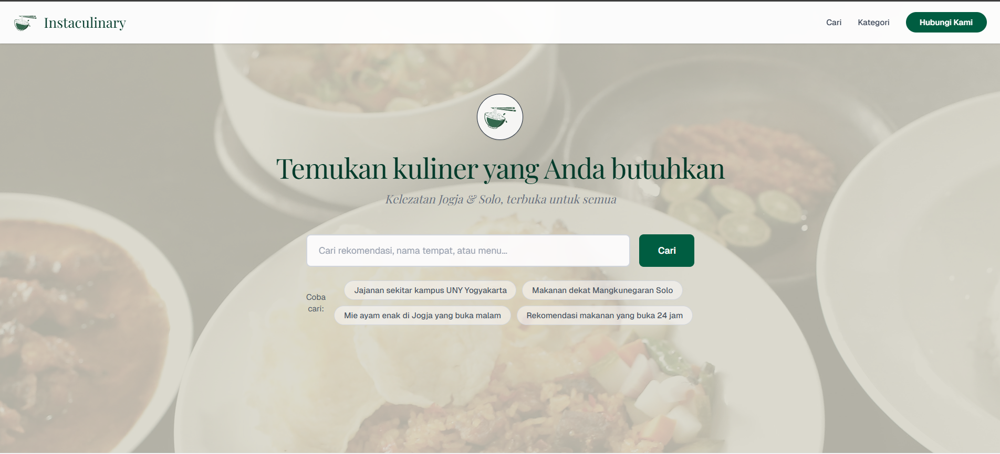

# Instaculinary

Find places to eat in Yogyakarta and Surakarta (Solo), with recommendations grounded in Instagram food vlogger data.

Instaculinary uses Retrieval-Augmented Generation (RAG) to turn everyday questions into dining recommendations with venue details and Instagram source links. Developed during a Data Scientist internship at DataIns, the project covers data preparation, semantic search, an API, and a web interface.



## User workflow

1. Open the web app and enter a question, such as "Ada rekomendasi gudeg di Yogyakarta?", or choose a suggested query and submit it.
2. Review recommendation cards with venue names, addresses, opening hours, prices, categories, and descriptions, where available.
3. Follow the Instagram source links to check the original information.

Each search is independent. The app currently has no conversation history or structured filters for location, price, or opening hours.

## Developer workflow

1. Prepare Instagram data through extraction, categorization, and LLM-assisted description and opinion processing. Export the final knowledge base as a CSV.
2. Validate records, generate 512-dimensional embeddings with Jina AI, and upload documents to an existing Pinecone index using `python -m src.create_vector_db`.
3. Retrieve the five closest documents for each question. Pass their context to DeepSeek through LangChain to generate structured recommendations.
4. Serve results through FastAPI and the Next.js API proxy, then render recommendation cards in the browser.
5. Validate changes with backend unit tests and frontend lint, type checks, production builds, and proxy integration tests. GitHub Actions runs these checks on pushes and pull requests.

```text
Data:   Instagram data -> extraction -> CSV -> Jina embeddings -> Pinecone
Search: Web app -> FastAPI -> Jina query embedding -> Pinecone -> DeepSeek -> cards
```

Updating the CSV requires re-ingestion before searches reflect the changes.

## Tech stack

| Layer | Technologies |
| --- | --- |
| Frontend | Next.js 16, React 19, TypeScript, Tailwind CSS 4 |
| Backend | Python 3.11+, FastAPI, Pydantic, Uvicorn |
| RAG orchestration | LangChain |
| Embeddings and retrieval | Jina AI (`jina-embeddings-v3`), Pinecone |
| Response generation | DeepSeek (`deepseek-chat`) |
| Data preparation | Pandas, Jupyter Notebook |
| CI | GitHub Actions |

## Run locally

Requires Python 3.11+, Node.js 20.9+, npm, API keys for DeepSeek, Jina AI, and Pinecone, and a populated 512-dimensional Pinecone index.

1. Create and activate a Python virtual environment, then run `python -m pip install -r requirements.txt`.
2. Copy `.env.example` to `.env` and fill in the provider keys and index name. Copy `frontend/.env.example` to `frontend/.env.local` and set the backend URL.
3. Start the backend from the repository root: `python -m uvicorn backend.api:app --reload --port 8000`.
4. In another terminal, open `frontend/`, run `npm ci`, then `npm run dev`. Open [localhost:3000](http://localhost:3000).

The dataset is not public. CSV files, notebooks, local models, and credentials are excluded from the repository; a clone alone cannot serve recommendations.

## Technical documentation

- [Architecture](docs/architecture.md): retrieval pipeline, model configuration, and request handling.
- [Data and ingestion](docs/data.md): CSV schema, Pinecone setup, and index updates.
- [Development](docs/development.md): platform-specific setup, tests, and CI.
- [Deployment](docs/deployment.md): manual deployment workflow and VPS requirements.

Interface inspired by [pasal.id](https://pasal.id) by [@ilhamfputra](https://github.com/ilhamfputra).
